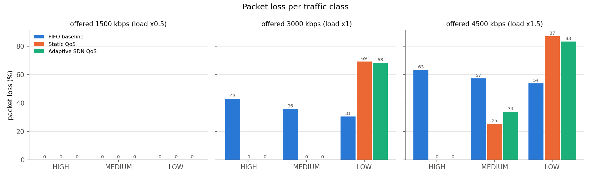
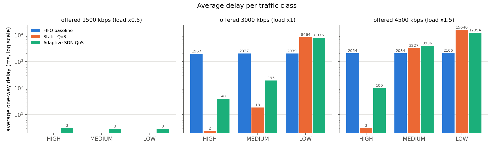
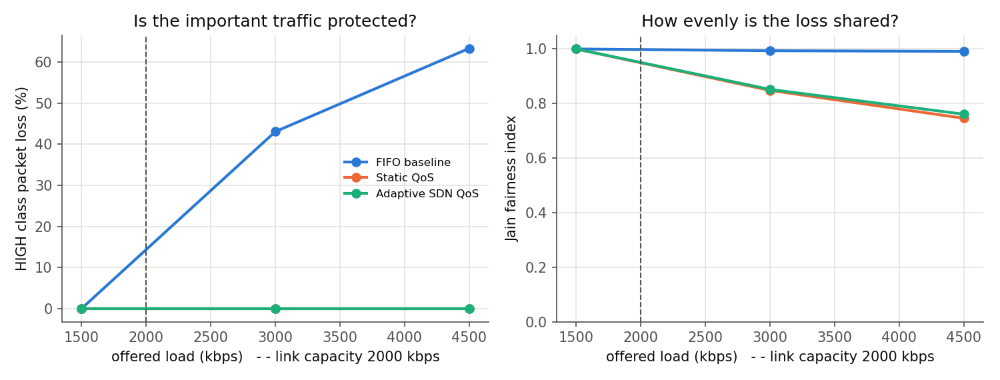
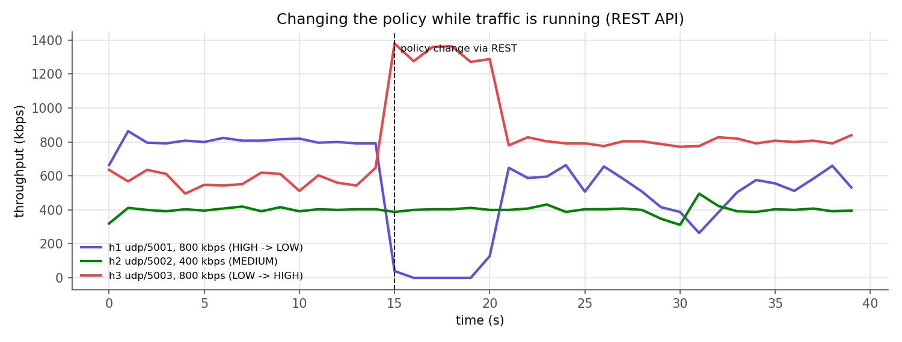
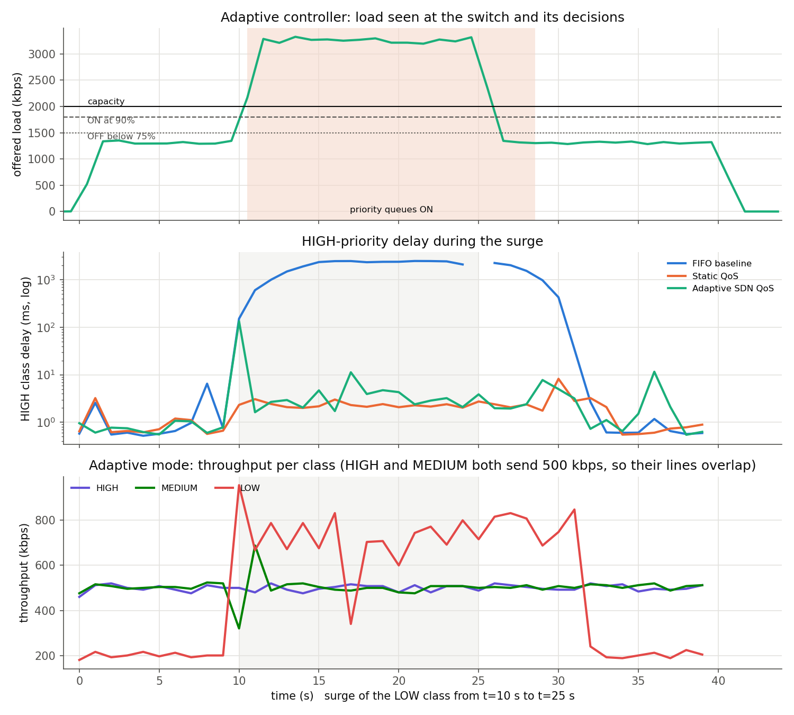

# QoS Traffic Management System (SDN + UDP)

A UDP application generates three classes of traffic (HIGH / MEDIUM / LOW) that compete for a
2 Mbps bottleneck in a Mininet network. A Ryu SDN controller (OpenFlow 1.3) **monitors the network
every second and, only when the link becomes congested, moves the flows into priority queues**,
so the important traffic keeps low loss and low delay. Policies can also be changed while traffic
is running, through a REST API. The receiver measures throughput, delay, jitter, packet loss and
fairness. The adaptive SDN approach is compared with a FIFO baseline and a static QoS
configuration under several load levels and a sudden traffic surge.

## Architecture

```
 h1 (HIGH   udp/5001)  --\
 h2 (MEDIUM udp/5002)  ---+--> s1 (Open vSwitch) --[2 Mbps, HTB queues q0..q3]--> h4 (udp_receiver)
 h3 (LOW    udp/5003)  --/        ^        |
                                  |        | port stats every 1 s
                        flow rules|        v
                           Ryu controller (qos_controller.py)  <-- REST :8080 (status / change policy)
```

| Queue | Used for | Priority |
|---|---|---|
| q0 | best effort: FIFO baseline, and adaptive mode when there is no congestion | highest |
| q1 / q2 / q3 | HIGH / MEDIUM / LOW while prioritising | 1 / 2 / 3 |

Controller modes (`QOS_MODE`):

| Mode | Behaviour |
|---|---|
| `fifo` | baseline: every flow shares one queue, no priority |
| `static` | priority queues always on |
| `adaptive` (default) | priority switched on above 90% link load and back off below 75% |

Full design: [`docs/DESIGN.md`](docs/DESIGN.md).

## Features

| Area | What it does | Where |
|---|---|---|
| UDP application | Three concurrent traffic classes; numbered, timestamped packets; FIN message for exact loss; fixed rates or rate profiles; error handling | `sockets/` |
| Measurement | Throughput, packet loss, delay, jitter, Jain's fairness index, per-second timeline per class | `sockets/udp_receiver.py` |
| SDN priority policies | Per-class OpenFlow rules that place each flow in an HTB queue | `controller/qos_controller.py` |
| Dynamic control | Port-stats monitoring every second; congestion detection with hysteresis; prioritisation switched on and off automatically | `controller/qos_controller.py` |
| Runtime policy changes | REST API to inspect the controller and change a flow's class while traffic runs | `controller/qos_controller.py` |
| Controlled congestion | 2 Mbps bottleneck; steady overload, a sudden traffic surge, and a live policy change | `topology/topo_run.py` |
| Evaluation | 3 modes × 3 load levels + surge + policy; graphs, summary table, automatic test checks | `run.sh`, `analysis/plot_results.py` |

## Repository layout

| Path | Contents |
|---|---|
| `sockets/` | UDP sender (client) and receiver (server and measurement); TCP client/server connectivity test |
| `controller/qos_controller.py` | Ryu controller: QoS rules, load monitor, adaptive policy, REST API, learning switch |
| `topology/topo_run.py` | Mininet topology, HTB queues on the bottleneck, scenarios (steady / surge / policy) |
| `analysis/plot_results.py` | Graphs, summary table and automatic PASS/FAIL test checks |
| `run.sh`, `setup.sh` | Run experiments / one-time install |
| `results/` | JSON per run, controller logs, `summary.md`, `plots/` |
| `docs/` | `DESIGN.md`, `TEST_CASES.md`, `RESULTS.md` |

## Requirements

Ubuntu/Debian Linux (native or VM) with `sudo` and internet access. Mininet needs a Linux kernel,
so plain macOS, Windows or WSL1 won't work.

## Build and run

```bash
git clone https://github.com/ADITHYA-JAYANTH/QoS-Traffic-Management-System.git
cd QoS-Traffic-Management-System
bash setup.sh          # once: Mininet, Open vSwitch, matplotlib, Ryu (private Python 3.9). Don't use sudo.
bash run.sh            # all experiments + graphs, ~10 minutes
```

| Command | What it does |
|---|---|
| `bash run.sh quick` | FIFO vs adaptive at 3000 kbps (~2 min) |
| `bash run.sh steady <fifo\|static\|adaptive> [load]` | one steady run; load 1.0 = 3000 kbps, 0.5 = 1500, 1.5 = 4500 |
| `bash run.sh surge [mode]` | traffic-surge scenario (all three modes if none is given) |
| `bash run.sh policy` | live policy change through the REST API at t = 15 s |
| `bash run.sh live [mode]` | 60 s of heavy traffic to experiment with, then the Mininet CLI |
| `bash run.sh plots` | rebuild graphs and `results/summary.md` from existing results |

If anything hangs: `sudo mn -c`.

### REST API (while the controller is running)

```bash
curl http://127.0.0.1:8080/qos/status                    # mode, congestion, load, which queue each flow uses
curl -X PUT http://127.0.0.1:8080/qos/policy/5003/HIGH   # move udp/5003 to the HIGH class right now
```

## Results

`bash run.sh` writes `results/summary.md` (every number plus PASS/FAIL for each automatic test) and
the graphs below. Analysis: [`docs/RESULTS.md`](docs/RESULTS.md). Test cases: [`docs/TEST_CASES.md`](docs/TEST_CASES.md).

| | |
|---|---|
|  |  |
|  |  |



## Team contributions

| Member | Deliverable 1 | Deliverable 2 |
|---|---|---|
| Adithya Jayanth | TCP/UDP sockets and measurement (`sockets/`) | FIN message, rate profiles, jitter / fairness / timeline metrics, error handling |
| Amudan Desikan | SDN controller and QoS policy (`controller/`) | Three controller modes, port-stats monitoring, adaptive congestion control, REST policy API |
| Advaith Krishnan | Topology, queues, integration, scripts (`topology/`, `setup.sh`, `run.sh`) | Surge and policy scenarios, experiment automation, plots, documentation and test cases |
