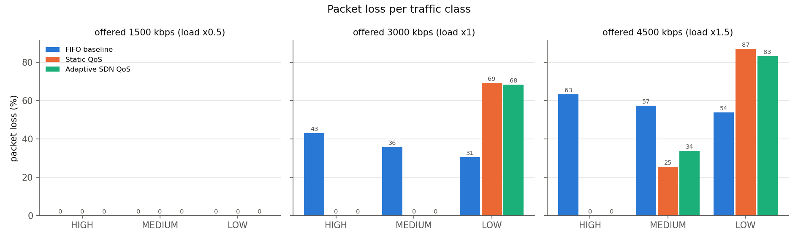
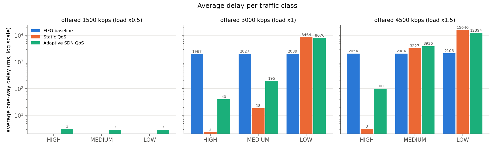
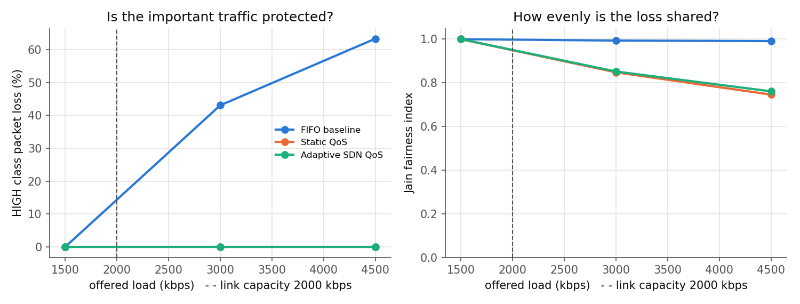
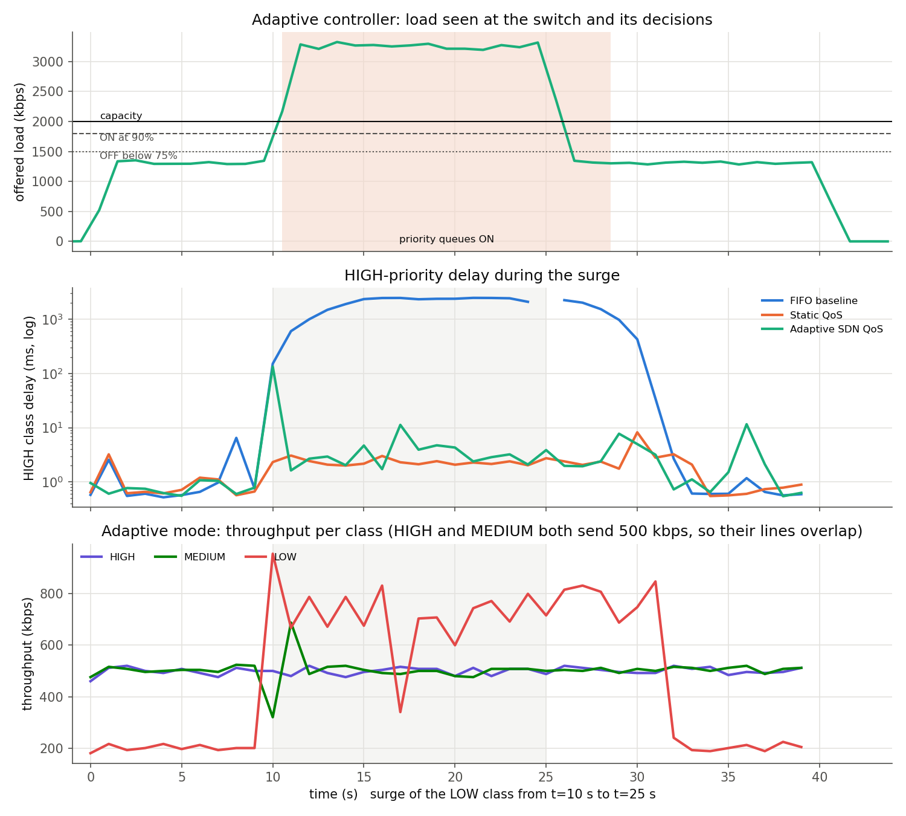
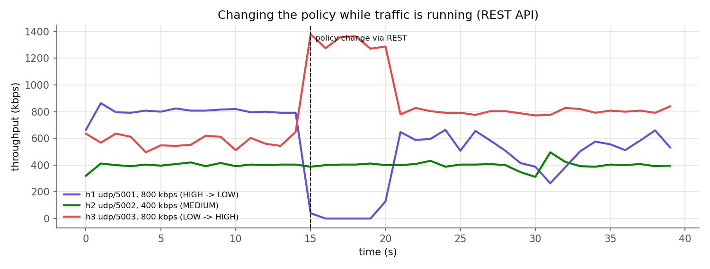

# Results and analysis

All results come from `bash run.sh`. It writes one JSON file per run, the graphs in
`results/plots/`, and `results/summary.md`, which holds every exact number plus a PASS/FAIL verdict
for each automatic test case. This page explains what the results show. Numbers below are rounded,
because they vary slightly from run to run; the exact values are in `results/summary.md`.

Steady runs send traffic for 20 s; the surge and policy runs last 40 s.

## 1. Metrics

| Metric | Meaning |
|---|---|
| loss % | packets sent but never received (the sender's FIN message tells the receiver how many were sent) |
| throughput | received kbps while the class was receiving |
| delay | one-way delay: arrival time − send timestamp |
| jitter | average change in delay between consecutive packets |
| Jain | fairness of the delivery ratios: 1.0 = every class loses the same share |

## 2. Steady load: three modes × three loads

**1500 kbps (below the 2000 kbps capacity).** Every mode gives 0% loss and sub-millisecond delay,
so QoS neither helps nor hurts when there is no congestion. In adaptive mode the controller never
switches priority on (test T11).

**3000 kbps (1.5× capacity).**

| Mode | HIGH loss | MEDIUM loss | LOW loss | HIGH delay | Jain |
|---|---|---|---|---|---|
| FIFO baseline | ~25–45% | ~25–45% | ~25–45% | ~2 s | ~0.99 |
| Static QoS | 0% | 0% | ~64% | ~1 ms | ~0.87 |
| Adaptive SDN QoS | 0% | 0% | ~64% | tens of ms (average) | ~0.87 |

* **FIFO:** the single shared queue fills up, so *every* class loses a large share of its packets
  and waits about 2 s (a full queue of 1000 packets takes about 2 s to drain at 2 Mbps). The important
  traffic is hurt as much as the bulk traffic.
* **Static and adaptive QoS:** HIGH and MEDIUM get everything they send with millisecond delay. LOW
  absorbs the overload: it gets only the leftover ~490 kbps, so its loss and delay are high. That is
  the intended trade-off.
* **Adaptive vs static:** the protection is the same (0% loss). Adaptive's average HIGH delay is
  higher only because of the first second, before the controller detects the congestion: packets
  queued in the shared queue during that second wait longer. After the switch, HIGH's delay is about
  1 ms, the same as static (see the surge timeline).

**4500 kbps (2.25× capacity).** Same pattern. HIGH still has 0% loss with QoS, compared with roughly
60% under FIFO. MEDIUM now loses about 20%, because HIGH + MEDIUM alone (2250 kbps) exceed the link:
QoS protects strictly in priority order.

**Fairness.** FIFO keeps Jain's index close to 1.0: every class loses roughly the same share. QoS
lowers it (about 0.87 at 3000 kbps, about 0.75 at 4500 kbps) because it is deliberately unequal, and
pushes more of the loss onto the lower classes as load increases. The left graph shows the payoff:
HIGH's loss stays at 0% at every load with QoS, while with FIFO it rises with the load.

## 3. Challenging scenario: traffic surge

HIGH (500 kbps) and MEDIUM (500 kbps) send steadily. LOW sends 200 kbps, then **surges to 2000 kbps
from t = 10 s to t = 25 s** (3000 kbps offered, 1.5× capacity), then drops back.

| Mode | HIGH loss | HIGH delay during the surge | LOW loss |
|---|---|---|---|
| FIFO baseline | ~15–20% | ~1.7 s | ~20% |
| Static QoS | 0% | ~1 ms | ~38% |
| Adaptive SDN QoS | 0% | ~10–15 ms (average) | ~38% |

* The adaptive controller switches priority **on within about a second** of the surge starting and
  **off about 3 s after it ends** (after three calm samples in a row). The exact times are printed in
  `results/summary.md`.
* With FIFO, HIGH is punished for something LOW did: its delay jumps to almost 2 s and it loses
  packets. With adaptive QoS, HIGH sees a short bump in the first second and is then back to about
  1 ms; LOW, the class that caused the congestion, takes the loss.
* After the surge, every class returns to normal in every mode.

## 4. Changing the policy at runtime (REST API)

Traffic: h1/udp 5001 at 800 kbps (HIGH), h2/udp 5002 at 400 kbps (MEDIUM), h3/udp 5003 at 800 kbps
(LOW): 2000 kbps in total, so the link is congested. At t = 15 s the experiment sends
`PUT /qos/policy/5003/HIGH` and `PUT /qos/policy/5001/LOW`.

| Flow | Throughput before → after | Delay before → after |
|---|---|---|
| h1 udp/5001 (HIGH → LOW) | ~800 → ~650 kbps | ~1 ms → several seconds |
| h2 udp/5002 (MEDIUM) | ~400 → ~400 kbps | ~2 ms → ~2 ms |
| h3 udp/5003 (LOW → HIGH) | ~650 → ~800 kbps | ~2 s → ~1 ms |

The two flows swap places as soon as the REST call arrives, and MEDIUM is unaffected. For about 3 s
after the change h3's throughput spikes and h1 receives almost nothing: h3's old packets are still
sitting in the LOW queue and drain first, and h1's packets now queue behind them.

## 5. Conclusions

1. Without QoS (FIFO), congestion hurts every application equally, including the time-critical one
   (around 2 s of delay and heavy loss for HIGH).
2. SDN-controlled priority queues keep the HIGH class at 0% loss and about 1 ms delay at 1.5× and
   2.25× overload, and during a sudden surge. The cost is paid by the LOW class, by design.
3. The adaptive controller detects congestion within about a second from port statistics, intervenes
   only while the link is congested, and returns to best effort afterwards. Compared with always-on
   static priority, it costs a short transition at the start of congestion.
4. Policies can be changed while traffic is running, and the effect is visible within a second.
